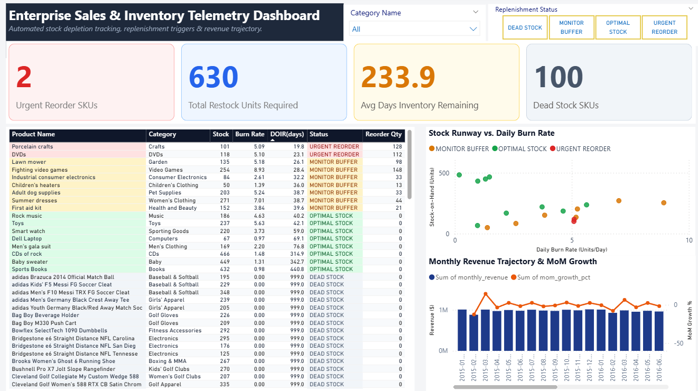

# Enterprise Supply Chain: Sales & Inventory Telemetry Platform

## Executive Summary
An enterprise-grade data analytics pipeline and business intelligence solution modeled on the **DataCo Global Smart Supply Chain** dataset (~180,000 transaction records). This project demonstrates the full analytical lifecycle: raw data staging, 3NF relational normalization, advanced analytical SQL modeling (Window Functions, CTEs, dynamic inventory formulas), and an interactive Power BI operational telemetry dashboard.

---

## Architecture & Data Pipeline
1. **Raw Ingestion & Staging**: Bulk CSV ingestion into MySQL 8.0 via `LOAD DATA LOCAL INFILE`.
2. **Relational Normalization (3NF)**: Decomposed a flat 53-column denormalized structure into 6 normalized relational entities (`dim_customers`, `dim_categories`, `dim_products`, `fact_orders`, `fact_order_items`, and `fact_inventory`) enforcing primary/foreign key constraints.
3. **Advanced SQL Analytics**:
   * **Categorical SKU Ranking**: Product revenue concentration per category using `DENSE_RANK()`.
   * **Financial Trajectory**: Month-over-Month (MoM) revenue momentum analysis utilizing `LAG()`.
   * **Inventory Velocity & Runway Telemetry**: Dynamic burn rate calculation, Days of Inventory Remaining (DOIR), and safety stock replenishment logic.
4. **BI & Executive Telemetry**: Real-time operational dashboard connected to database views, tracking critical stockouts, restock demand, and capital efficiency.

---

## Core SQL Logic Excerpt: Dynamic Replenishment & DOIR
```sql
WITH trailing_demand AS (
    SELECT 
        oi.product_id,
        SUM(oi.order_item_quantity) AS trailing_units,
        ROUND(SUM(oi.order_item_quantity) / 90.0, 2) AS daily_burn_rate
    FROM fact_order_items oi
    JOIN fact_orders o ON oi.order_id = o.order_id
    CROSS JOIN (SELECT MAX(order_date) AS anchor_date FROM fact_orders) md
    WHERE o.order_date >= md.anchor_date - INTERVAL 90 DAY
      AND o.order_status NOT IN ('CANCELED', 'SUSPECTED_FRAUD')
    GROUP BY oi.product_id
)
SELECT 
    p.product_id,
    p.product_name,
    c.category_name,
    inv.stock_on_hand,
    COALESCE(td.daily_burn_rate, 0) AS daily_burn_rate,
    -- Days of Inventory Remaining (DOIR)
    CASE 
        WHEN COALESCE(td.daily_burn_rate, 0) = 0 THEN 999.0 
        ELSE ROUND(inv.stock_on_hand / td.daily_burn_rate, 1)
    END AS days_inventory_remaining,
    -- Operational Status Triggers
    CASE 
        WHEN COALESCE(td.daily_burn_rate, 0) = 0 THEN 'DEAD STOCK'
        WHEN (inv.stock_on_hand / NULLIF(td.daily_burn_rate, 0)) <= 25.0 THEN 'URGENT REORDER'
        WHEN (inv.stock_on_hand / NULLIF(td.daily_burn_rate, 0)) <= 40.0 THEN 'MONITOR BUFFER'
        ELSE 'OPTIMAL STOCK'
    END AS replenishment_status,
    -- Recommended Replenishment Quantity
    CASE 
        WHEN (inv.stock_on_hand / NULLIF(td.daily_burn_rate, 0)) <= 40.0
        THEN GREATEST(0, ROUND((td.daily_burn_rate * 45) - inv.stock_on_hand, 0))
        ELSE 0 
    END AS recommended_reorder_qty
FROM dim_products p
JOIN dim_categories c ON p.category_id = c.category_id
JOIN fact_inventory inv ON p.product_id = inv.product_id
LEFT JOIN trailing_demand td ON p.product_id = td.product_id;
```

---

## Power BI Dashboard Preview


### Key Dashboard Modules:
* **Operational Health Cards**: Instant visibility into high-risk SKUs, total units needed for restock batches, and dormant inventory capital.
* **Automated Restock Action Grid**: Prioritized operational purchase list sorted by DOIR with conditional threshold alerts.
* **Depletion Velocity Scatter Plot**: Isolates high-burn, low-stock items at risk of immediate stockouts.
* **Revenue vs. MoM Momentum**: Dual-axis financial trajectory identifying demand surges against supply chain buffers.